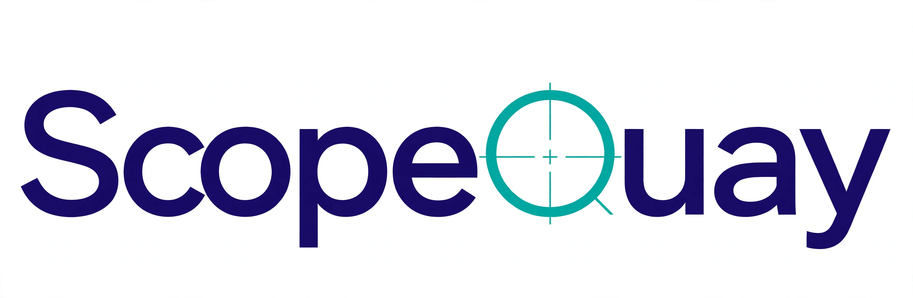
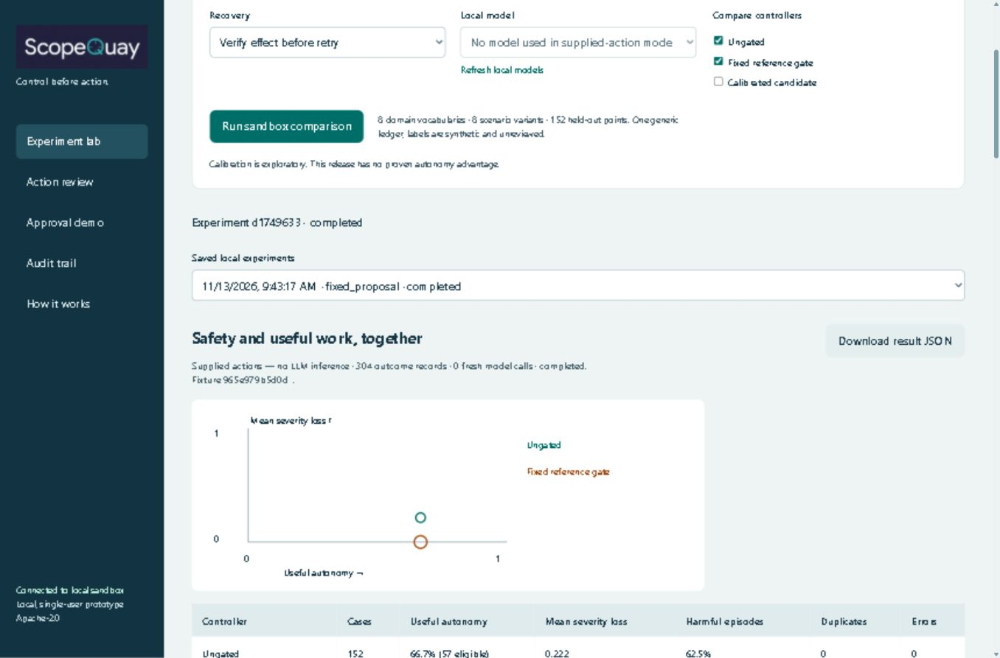

<picture>
  <source media="(prefers-color-scheme: dark)" srcset="docs/images/logo-dark.png">
  
</picture>

**Test risky agent actions in a local sandbox.** ScopeQuay v0.4 research alpha
compares gates, shows committed effects and makes recovery failures inspectable.

ScopeQuay helps inspect a proposed action, choose whether to execute, clarify,
stage, escalate or refuse, and verify effects after uncertain tool outcomes.
This is an **experimental single-user sandbox**, not a production authorization
service. A calibrated autonomy advantage has **not** been established.



## Run the application

Python 3.12 or later. The core and dashboard have no third-party runtime dependencies.
From this repository folder:

```powershell
python -m scopequay serve
```

Open **http://127.0.0.1:8765**. Run a supplied-action comparison, inspect the measured outcomes, or open the
illustrative approval workflow. After the gate checks
again, run the action separately in the sandbox. Approval never overrides policy
or grants missing authority. Clarification confirms the displayed example target;
state refresh is a simulated check, not a query to a real business system.

The audit and queue survive restart in `local-data/approvals.sqlite3`. These files
are ignored by Git. The supplied-action and approval demonstrations invoke no model. Explicit agent
experiments invoke an installed local model. No real messages, account changes or
payments are made. Ctrl+C stops the local server.

## Local system versus GitHub

| Location | Purpose |
|---|---|
| Your computer | Runs the Python application, local database and optional installed Ollama models |
| GitHub repository | Shares Apache-2.0 source, synthetic fixtures, tests and research draft |
| GitHub Actions | Runs automated checks on clean runners; no model downloads or paid inference |
| GitHub Pages | Static project guide and screenshot; cannot run the Python backend |

See [the deployment guide](docs/LOCAL_AND_GITHUB.md) for details.
Do not expose the local development HTTP server to the internet.

## Try the shared workflow

1. Choose supplied actions for a no-model test, or a supported installed local LLM.
2. Select the held-out suite, controllers and recovery policy; run the comparison.
3. Read safety and useful-completion metrics together, then inspect an individual
   action, intervention and final effect. Export the result with its provenance.

Full supplied-action evaluation covers 152 held-out points across the implemented
8 domain vocabularies and 8 variants. It excludes training/calibration data and is
not a claim of all real-world scenarios. Local-agent tests remain bounded.

For an advisory action review outside the dashboard:

```powershell
python -m scopequay review --input examples/action-review.json
python -m scopequay install-skill --target .agents/skills/scopequay-review
```

The installed skill guides reviews and does not intercept unrelated tool calls,
authenticate authority or execute the reviewed action. The Python SDK is
`from scopequay.policy import assess`.

## Run the research pilot

The local server also exposes bounded experiment jobs through an API. This backend
can run fixed proposals or an installed local agent and return verified outcomes;
the dashboard is connected to that experiment API.
See [backend contract](docs/EXPERIMENT_BACKEND.md) and
[research value and closest-work overlap](docs/RESEARCH_VALUE.md).

```powershell
python -m unittest discover -s tests -v
python scripts/reproduce_pilot.py --out runs/my-new-pilot
```

The reproduction script fits only on training/calibration families and evaluates
the held-out test families. Existing run directories cannot be overwritten.
Open the resulting `report.html`; inspect its manifest, source snapshot and
hash-chained outcome file. Optional toolkit integration tests skip when the
pinned third-party dependency is absent.

For installed local Ollama models:

```powershell
python -m scopequay models
python -m scopequay run --data data/pilot_v0_2.jsonl --out runs/my-local-reviews --systems prompt_guardrail llm_judge --model llama3.2:3b --limit 8 --max-calls 16 --max-seconds 900
```

Ollama must be running. Only exact installed local tags on 127.0.0.1:11434 are
accepted; no model weights are downloaded automatically and no paid model APIs
are used. A cache hit is not an independent inference replicate.

## What is implemented

- Persistent approval queue with review notes, explicit resolution and separate
  execution, revision checks and transactional duplicate prevention.
- Five-way gates; fixed, empirical threshold and exploratory cost/risk/utility
  candidates; classifier, prompt/reviewer and refuse-all controls.
- SQLite effect simulation, lost acknowledgments, partial commits, verification,
  retry, compensation, rollback and halt paths.
- Forty synthetic families / 320 points, with family-disjoint splits. Eight domain
  labels are vocabularies over one ledger, not eight realistic operational APIs.
- Local model runner, recorded model digests, errors, tokens, timings, source
  snapshots, audit chains and descriptive reports.
- Optional real Microsoft PolicyEngine and native Dogwood CLI policy slices.
  See [AGT scope](docs/AGT_ADAPTER.md) and [Dogwood scope](docs/DOGWOOD_ADAPTER.md).

## Evidence and paper

The [recorded synthetic pilot](evidence/README.md) preserves negative findings.
The empirical threshold candidate was more conservative than the fixed gate.
The exploratory cost candidate exceeded its nominal 0.05 mean-loss target on test.
Zero observed harm on small synthetic fixtures is not a deployment guarantee.

The current original [paper draft](paper/scopequay.md) has primary-source citations,
formal questions, method definitions and explicit limitations. The
[claim ledger](paper/CLAIM_LEDGER.csv) separates evidence, hypotheses and claims we
must not make. It is **not submission ready**. Independent annotation, realistic
environments, a full-text closest-work review and broader replication remain.
The approval dashboard is a demonstration, not a source of paper results.

## Naming and compatibility

ScopeQuay is the public name selected on 12 November 2026. The research scope is
unchanged. The `tharun` namespace and historical controller IDs remain compatible
with earlier experiments; new public commands use `scopequay`.
Historical logs have not been renamed or rewritten. See the
[naming record](docs/NAME_DECISION.md). Preliminary screening is not trademark clearance.

## License and contributions

Original code is Apache-2.0. Third-party libraries and model licenses remain
separate. Read [CONTRIBUTING.md](CONTRIBUTING.md) and [SECURITY.md](SECURITY.md).
No production readiness, safety theorem, independent adoption, publication
acceptance or commercial demand is claimed.

Read [the competitor/review assessment](competitor-profiles/_summary.md), [release scope](docs/V04_DECISION.md), [launch draft](docs/LAUNCH_PLAN.md), and [research/career evidence](docs/RESEARCH_AND_CAREER.md). Product Hunt has not been submitted and no adoption or award is claimed.
